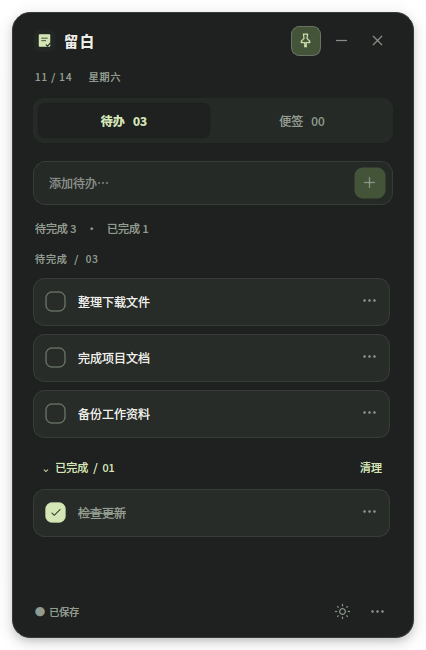

# 留白 · Liubai

Windows / Linux 桌面待办与便签。原生 Qt 界面，默认置顶，本地自动保存。



- 待办：新增、编辑、完成、折叠已完成项、批量清理。
- 便签：多张便签、标题与正文、颜色标记。
- 窗口：置顶、拖动、缩放、托盘、位置记忆、深浅主题。
- 数据：自动保存、上一版备份、导出和合并导入，删除后 8 秒内可撤销。
- 支持中文输入和可选登录启动，无需账号或网络服务。

## 下载

从 [GitHub Releases](https://github.com/JebKerman114/liubai/releases/latest) 下载对应系统和架构的文件。

| 系统 | 架构 | 格式 |
| --- | --- | --- |
| Windows | x64、ARM64 | `-setup.exe`、`.msi`、`-portable.zip`、`-unsigned.msix` |
| Linux | x86_64、aarch64 | `.AppImage`、`.deb`、`.rpm`、`.pkg.tar.zst`、`.tar.gz`、`.flatpak`、`.snap` |

Windows x64 需要 Windows 10 2004 或更新系统；ARM64 需要 Windows 11。Linux 原生程序需要 **glibc 2.39+**，例如 Ubuntu 24.04+、Debian 13+、较新的 Fedora / Arch。提供的二进制文件适用于 x64 和 ARM64；PySide6 官方没有 x86 32 位、ARMv7、RISC-V、LoongArch 或 musl / Alpine 的对应预编译包，因此没有把其他架构标成受支持目标。

Windows 推荐安装 EXE 或便携 ZIP。EXE / MSI 没有代码签名；MSIX 是供自行签名部署的未签名包，不能直接作为受信任安装包安装。不分发签名私钥或临时自签名证书。

Linux 推荐 AppImage。DEB 对应 Debian / Ubuntu，RPM 对应 Fedora 等，`pkg.tar.zst` 对应 Arch。AppImage 没有 FUSE 时可加 `--appimage-extract-and-run` 启动。Flatpak 使用 KDE Platform 6.10；Snap 为本地安装的 classic 包。目前没有发布到 Microsoft Store、Flathub 或 Snap Store。

```sh
# AppImage
chmod +x liubai-*-linux-x86_64.AppImage
./liubai-*-linux-x86_64.AppImage

# Flatpak：先配置 Flathub，再安装对应架构的包
flatpak remote-add --user --if-not-exists flathub https://flathub.org/repo/flathub.flatpakrepo
flatpak install --user ./liubai-1.0.0-linux-x86_64.flatpak

# Snap：安装对应架构的 classic 包
sudo snap install --dangerous --classic ./liubai-1.0.0-linux-x86_64.snap
```

每次正式发布包含 22 个安装 / 便携文件及 `SHA256SUMS`。构建目标和打包后启动检查见 [Actions](https://github.com/JebKerman114/liubai/actions)。Windows、Linux 及两个架构均在对应的原生构建机上生成。

## 使用

顶部图钉切换置顶，拖动标题栏移动窗口，右下角调整大小。关闭窗口后收起到系统托盘；没有托盘时直接退出。从应用菜单再次启动会唤出已有窗口。

| 快捷键 | 操作 |
| --- | --- |
| Enter | 添加待办 |
| Ctrl+1 / Ctrl+2 | 切换待办 / 便签 |
| Ctrl+N | 聚焦待办输入框 / 新建便签 |
| Ctrl+Shift+P | 切换置顶 |
| Ctrl+S | 立即保存 |
| Ctrl+Q | 完全退出 |
| Esc | 从便签编辑返回列表 |

快捷键在留白窗口获得焦点时生效。设置菜单提供跨虚拟桌面显示、登录启动和备份操作。

Linux 置顶主要适配 KDE Plasma / KWin X11。其他 X11 / XWayland 环境取决于窗口管理器对 EWMH 的支持；Wayland 原生协议下的跨桌面置顶尚未适配。Windows 使用 Qt 的原生窗口置顶。Linux 的 Fcitx 5 在缺少原生 Qt 插件时会通过 Qt 内置 IBus 插件连接，不修改系统输入法配置。

## 数据

| 系统 | 默认目录 |
| --- | --- |
| Linux | `~/.local/share/liubai`，遵循 `XDG_DATA_HOME` |
| Windows | `%LOCALAPPDATA%\Liubai` |

`data.json` 为当前数据，`data.backup.json` 为上一版。输入停止 400 毫秒后自动保存，正常退出前立即保存。数据为本机明文 JSON。导入备份会合并新记录，相同 ID 保留当前记录。应用包不包含个人数据。

## 从源码运行

需要 Python 3.10–3.14 和 PySide6 Essentials 6.12.0。正式包内置 Python / Qt，不需要自行安装依赖。

```sh
python -m venv .venv
# Linux：source .venv/bin/activate
# Windows PowerShell：.venv\Scripts\Activate.ps1
python -m pip install -r requirements.txt
python main.py
```

Linux 可用 `./launch.sh` 启动，执行 `python3 install.py` 安装到当前用户的应用菜单。虚拟环境用户应使用该环境的 Python 执行安装。

## 测试与打包

```sh
python -m unittest discover -s tests -v
# Linux：QT_QPA_PLATFORM=offscreen python tests/check_ui.py
# Windows PowerShell：$env:QT_QPA_PLATFORM='offscreen'; python tests/check_ui.py
```

测试使用临时目录，覆盖数据恢复、待办操作、便签自动保存、主题、删除撤销和重启持久化。

详见 [构建说明](docs/BUILDING.md)。在 GitHub Actions 运行 `Build and release`，`release_tag` 留空只构建，填写与程序版本一致的标签（例如 `v1.0.0`）将在四个目标全部通过后发布 Release。

## 许可

[MIT](LICENSE)。Python、PySide6 / Qt 和 PyInstaller 等组件保留各自许可，见 [第三方声明](THIRD_PARTY_NOTICES.md)。
